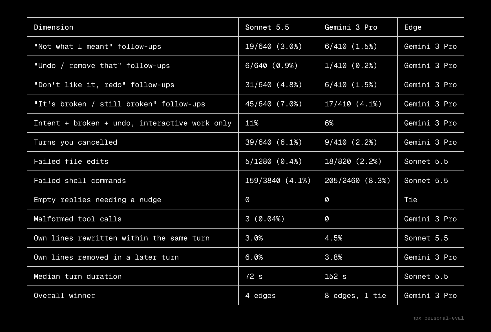

# personal-eval

**Which model actually works best for *you*?**

```sh
npx personal-eval
```

`personal-eval` reads the coding-agent sessions already on your machine and scores your models on
the only benchmark that matters to you: how often *you* had to correct them.



Inspired by Guillermo Rauch's [personal eval](https://x.com/rauchg/status/2124880074168242369): he had an agent study all of
his coding sessions and decide between two models. This does the same in one command, with no agent required, in a few
seconds.

## What it measures

Every row is "lower is better". Each turn is attributed to the model that ran it.

| Row | How it's computed |
|---|---|
| "Not what I meant" follow-ups | Your next message says the agent misunderstood ("no, I meant…", "wrong file"). |
| "Undo / remove that" follow-ups | Your next message asks to revert or remove what it just did. |
| "Don't like it, redo" follow-ups | Your next message asks for the work again or differently. |
| "It's broken / still broken" follow-ups | Your next message reports that it doesn't work, or pastes an error. |
| Intent + broken + undo, interactive work only | Any of the misunderstood, undo or broken follow-ups, counting only sessions where you sent at least two messages. |
| Turns you cancelled | Turns you interrupted (Esc / Ctrl-C / stop). |
| Failed file edits | Edit or write tool calls that failed (string not found, patch didn't apply, …). |
| Failed shell commands | Shell commands that exited non-zero. |
| Empty replies needing a nudge | The model's last message had no text and no tool call: it just stopped. |
| Malformed tool calls | Tool calls with invalid arguments, unknown tool names, or unparseable JSON. |
| Own lines rewritten within the same turn | Lines the model wrote and then changed again before handing back. |
| Own lines removed in a later turn | Lines the model wrote that were removed in a later turn. Single edits adding 500+ lines (generated or data files) are ignored. |
| Median turn duration | From your message to the agent's last action, cancelled turns excluded. |

The **Edge** column names the better model per row, and **Overall winner** counts edges.

Follow-ups are labeled locally with keyword rules by default. `--judge` has Claude label them instead, which is more
accurate (see below).

## Supported agents

| Agent | Where sessions are read from |
|---|---|
| Claude Code | `~/.claude/projects/` (or `$CLAUDE_CONFIG_DIR`) |
| Codex | `~/.codex/sessions/` and `archived_sessions/`, `.jsonl` and `.jsonl.zst` (or `$CODEX_HOME`) |
| Gemini CLI | `~/.gemini/tmp/*/chats/` (or `$GEMINI_CLI_HOME`) |
| opencode | `~/.local/share/opencode/` sqlite and JSON storage (or `$XDG_DATA_HOME`, `$OPENCODE_DB`) |
| fx | `~/.fx/sessions/` (or `$FX_HOME`) |

Sub-agent and side-chain sessions are skipped, so the numbers reflect the model you were talking to. Messages injected by
the harness (tool results, notifications, scheduled automations, context blocks) don't count as your follow-ups.

## Options

```
--models <a,b>     models to compare (substring of name or id, e.g. "opus,gpt-6")
                   default: your two most-used models
--all              compare every model with enough turns (up to 6)
--list             list the models found and exit
--since <when>     only sessions after a date (2026-10-01) or age (30d, 12w)
--agent <ids>      limit to agents: claude, codex, gemini, opencode, fx
--project <text>   only sessions whose working directory contains <text>
--min-turns <n>    minimum turns for a model to be eligible (default 30)
--strict           call a row a tie unless the gap is statistically significant
--judge            label follow-ups with Claude instead of keyword rules
--judge-model <m>  model for --judge
--out <file>       image path (default ~/Downloads/personal-eval.png)
--no-image         skip the image
--json             print raw numbers as JSON
```

## Privacy

Everything runs locally. Your sessions are never uploaded, and there is no telemetry.

The one exception is `--judge`. It sends short snippets to Claude: the last 240 characters of each agent reply and the
first 360 characters of your next message. It uses your local `claude` CLI if you have Claude Code (with your MCP
servers, settings and tools disabled for the call), otherwise `ANTHROPIC_API_KEY`. Labels are cached in
`~/.cache/personal-eval/` so re-runs only send new messages.

## Caveats

- **Different agents, different harnesses.** If your models ran in different tools (say Opus in Claude Code and GPT in
  Codex), the comparison includes harness differences. The CLI tells you when that's the case.
- **Different work.** You probably don't give every model the same tasks. `--project` and `--since` help you compare
  like with like.
- **Small samples.** A model with a few dozen follow-ups can win rows by luck. Use `--strict` to count only
  statistically significant gaps (two-proportion z-test, p < 0.05).
- **Claude Code deletes transcripts after 30 days** by default. Set `"cleanupPeriodDays": 365` in
  `~/.claude/settings.json` to keep more history for next time.

## Requirements

Node 20+. Reading Codex's compressed sessions needs Node 22.15+ (or the `zstd` CLI); reading opencode's sqlite needs
Node 22.5+.

## Development

```sh
npm install
npm test
node bin/personal-eval.js --list
```

---

Built by [Agnost AI](https://agnost.ai). We do the same thing for production agents: find where users had to correct
them, and turn it into fixes.
